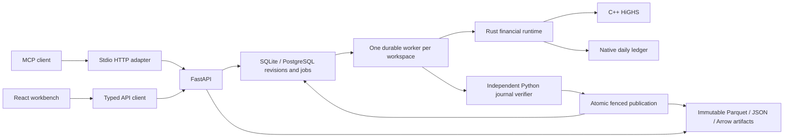

# Architecture

Rates Workbench is a modular monolith with a React workbench, a FastAPI service,
a dedicated worker, native financial runtimes, and durable storage. The current
production policy is [rust-production-contract.md](rust-production-contract.md).
Python financial implementations are independent reference oracles for tests.

## Ownership

| Layer | Responsibilities |
|---|---|
| `apps/mcp` | Permission-scoped MCP tools/resources over HTTP, with separate operations and strategy profiles. Reviewed generated route coverage, enforced role actions, bounded result transport and exact-retry recovery; no financial runtime or database ownership. See [agent interface](../apps/mcp/README.md). |
| `apps/web` | Workbench interaction, tables/charts, polling and rendering. All transport goes through `src/lib/api.ts`. |
| `apps/api/app/main.py` and feature routers | Request/response validation, admission and durable enqueueing. No product mathematics. |
| `app/store.py` | Compatibility facade and the sole local materialization of durable revision state. |
| `app/state_views.py`, `app/contracts.py` | Snapshot restoration, explicit state port and typed metadata. |
| `app/operations.py` | Allowlisted application composition, preserving existing queued operation names. |
| `app/*_jobs.py` | Domain engine adapters. The caller supplies the state owner; no duplicated state dictionaries. |
| `app/telemetry.py`, `app/job_queue.py`, `app/result_transport.py` | Progress/workload metadata, queue orchestration and ARW1 transport. |
| `app/persistence.py`, `app/repository.py`, `app/artifacts.py` | Durable revisions/jobs, portable transactional SQL and immutable checksummed objects. Storage does not import feature handlers. |
| `app/worker.py` | Lease ownership, one heavy job at a time, recovery, native invocation and publication fencing. |
| `portfolio-risk` Python package | Public input/output adapters, explicit test reference calculations and independent verification. |
| `portfolio-risk-native` | Built-in pricing, calibration, shared draws, dependency graph, risk/income/forecast controllers and treasury. |
| `portfolio-decision-native` | Transactional edit/strategy coordinator, LP construction, HiGHS invocation, allocation validation and combined workflow. |
| `portfolio-ledger-native` | Raw daily-spec normalization, bounded daily event/GL execution and closing reduction. |
| `portfolio-model-core` | Shared bounded credit, exact-observation fitting, dated contracts and supplied-fixing arithmetic. Its analysis entrypoints do not imply full scenario/ledger integration. |
| `portfolio-compute-control` | Shared native deadline/cancellation checkpoints. |

## Revision and execution flow

Inputs are typed snapshots of books, markets, assumptions, settings and provenance.
An edit commits a new SQL revision and invalidates incompatible published
coefficients. Module dictionaries are a local materialization of this revision,
not another durable source of truth. Each deployment process serves one configured
tenant/workspace; request parameters cannot select a tenant or artifact prefix.

The API snapshots submitted inputs and enqueues an immutable request with its
revision and model/binary identity. A separate worker acquires a workspace lease,
claims an attempt token, resolves the named operation, and executes it against the
captured inputs. Cancellation, deadline, lost lease, stale revision or failed writes
must not publish interactive state or a completed manifest.

Large result tables live in immutable local/S3 Parquet objects. References commit
after writes succeed. Daily workflow postings are independently replayed before
the verified manifest is atomically published. Optional Iceberg delivery uses the
existing receipt/idempotency contract. SQLite and PostgreSQL share the SQL layer.

The memory queue and its thread executor are for isolated tests only. They are
not a selectable production Python calculation runtime. Production execution
requires Rust and matching native artifacts; historical Python settings/results
remain readable and require an explicit settings edit/rebuild before execution.

## Native boundaries

Explicit product-analysis jobs invoke bounded native contracts in a cancellable
standalone process; adapters store raw inputs, format native output and retain
source/executable identities. Dated library preparation publishes through the
same durable library transaction and recovery path as legacy prepared libraries.
Its synchronous evaluator consumes native coefficients without repricing. See
[product analysis and dated adoption](models/product-analysis-workbench.md).

Product batches use borrowed contiguous buffers over C ABI 8 or bounded tagged
JSON requests with opaque graph/session handles. Standalone lifecycle, strategy,
balance and workflow executables also accept bounded protocols. Large workflows
stream table partitions rather than constructing a full cashflow/journal JSON
document across Python/Rust. Native deadlines and the process watchdog protect
transport and execution; component budgets are not a claim of an aggregate RSS cap.

HiGHS remains C++. Rust constructs its financial problem, invokes the bounded
solver and validates allocation amounts. Python never provides a built-in financial
callback inside Rust. Custom Python research extensions remain explicitly separate.

## Financial contracts and interactivity

Each run shares common random numbers. Base OAS is calibrated once and held fixed
under scenario revaluation. Cashflow-factor generation is separate from spread
discounting, so spread solves reuse monthly factors or exact-time CSR schedules.
Scenario/path reuse and bounded dependency caches follow complete content identity;
eviction may cause recomputation, never changed economics. Numerical reduction
order, accounting anchors and final-output tolerances are correctness contracts.

Unit-library builds perform expensive pricing and prepare coefficients. Synchronous
strategy evaluation reads the atomically published revision/backend bundle and
combines coefficients; it never reprices or recovers a session in a request handler.
Slow rebuilds belong to durable jobs. Decision constraint-only updates invoke no
pricers. Source changes require explicit rebuilds rather than silently changing
saved economics. Unsupported prepayment edits retain RESTART_REQUIRED behavior.

## Model scope and verification

Research regulatory weights, approximate forward units, monthly captured flows,
supplied FTP/regulatory assumptions and unsupported hedge/netting mappings retain
their disclosed limits. Conditional forecasts remain income-only. New model-core
analysis contracts do not prove empirical predictive accuracy or replace all daily
product schedules. See [models/implementation-plan.md](models/implementation-plan.md).

Independent Python/native final-output parity, native ownership tests, fresh-process
production defaults, durable worker restart/failure tests and browser flows gate
changes. Static boundaries and generated contracts complement these behavioral
checks. [contracts/README.md](contracts/README.md) documents generators, transport
exceptions and reviewed dependency cycles. CI configuration records intended
coverage; a validation report records checks actually run on a stated platform.

## Build and extension workflow

Build all three native runtime artifacts with `make build-native`, restart
API/workers, and rebuild libraries/sessions whose identity changed. `make build`
also builds the web app. `make check-architecture` checks static rules and generated
contracts; `make test-py` and browser/native suites retain their existing gates.
New products follow the engine recipe first, then adapters, book UI/KRD keys and
unit templates. Financial logic belongs in Rust; adapters transport and format.

The original pre-migration architectural discussion is preserved in
[reviews/2026-10-01-architecture-historical.md](reviews/2026-10-01-architecture-historical.md).
It describes earlier Numba/thread/in-memory stages, not current production policy.
