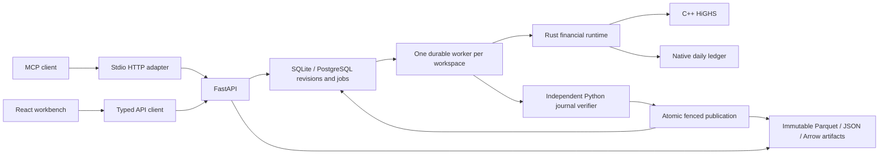

# Architecture

Rates Workbench is a modular monolith with a React workbench, a FastAPI service,
a dedicated worker, native financial runtimes, and durable storage. The current
production policy is [rust-production-contract.md](rust-production-contract.md).
Python financial implementations are independent reference oracles for tests.



## Ownership

| Layer | Responsibilities |
|---|---|
| `apps/mcp` | Permission-scoped MCP tools/resources over HTTP, with separate operations and strategy profiles. Reviewed generated route coverage, enforced role actions, bounded result transport and exact-retry recovery; no financial runtime or database ownership. See [agent interface](../apps/mcp/README.md). |
| `apps/web` | Workbench interaction, tables/charts, polling and rendering. All transport goes through `src/lib/api.ts`. |
| `apps/api/app/main.py` and feature routers | Request/response validation, admission and durable enqueueing. No product mathematics. |
| `app/store.py` | Compatibility facade and the sole local materialization of durable revision state. |
| `app/state_views.py`, `app/contracts.py` | Snapshot restoration, explicit state port and typed metadata. |
| `app/operations.py` | Allowlisted application composition, preserving existing queued operation names. |
| `app/*_jobs.py` | Domain engine adapters. The caller supplies the state owner; no duplicated state dictionaries. |
| `app/telemetry.py`, `app/job_queue.py`, `app/result_transport.py` | Progress/workload metadata, queue orchestration and ARW1 transport. |
| `app/persistence.py`, `app/repository.py`, `app/artifacts.py` | Durable revisions/jobs, portable transactional SQL and immutable checksummed objects. Storage does not import feature handlers. |
| `app/worker.py` | Lease ownership, one heavy job at a time, recovery, native invocation and publication fencing. |
| `portfolio-risk` Python package | Public input/output adapters, explicit test reference calculations and independent verification. |
| `portfolio-risk-native` | Built-in pricing, calibration, shared draws, dependency graph, risk/income/forecast controllers and treasury. |
| `portfolio-decision-native` | Transactional edit/strategy coordinator, LP construction, HiGHS invocation, allocation validation and combined workflow. |
| `portfolio-ledger-native` | Raw daily-spec normalization, bounded daily event/GL execution and closing reduction. |
| `portfolio-model-core` | Shared bounded credit, exact-observation fitting, dated contracts and supplied-fixing arithmetic. Its analysis entrypoints do not imply full scenario/ledger integration. |
| `portfolio-compute-control` | Shared native deadline/cancellation checkpoints. |

## Revision and execution flow

Inputs are typed snapshots of books, markets, assumptions, settings and provenance.
An edit commits a new SQL revision and invalidates incompatible published
coefficients. Module dictionaries are a local materialization of this revision,
not another durable source of truth. Each deployment process serves one configured
tenant/workspace; request parameters cannot select a tenant or artifact prefix.

The API snapshots submitted inputs and enqueues an immutable request with its
revision and model/binary identity. A separate worker acquires a workspace lease,
claims an attempt token, resolves the named operation, and executes it against the
captured inputs. Cancellation, deadline, lost lease, stale revision or failed writes
must not publish interactive state or a completed manifest.

Large result tables live in immutable local/S3 Parquet objects. References commit
after writes succeed. Daily workflow postings are independently replayed before
the verified manifest is atomically published. Optional Iceberg delivery uses the
existing receipt/idempotency contract. SQLite and PostgreSQL share the SQL layer.

The memory queue and its thread executor are for isolated tests only. They are
not a selectable production Python calculation runtime. Production execution
requires Rust and matching native artifacts; historical Python settings/results
remain readable and require an explicit settings edit/rebuild before execution.

## Native boundaries

Explicit product-analysis jobs invoke bounded native contracts in a cancellable
standalone process; adapters store raw inputs, format native output and retain
source/executable identities. Dated library preparation publishes through the
same durable library transaction and recovery path as legacy prepared libraries.
Its synchronous evaluator consumes native coefficients without repricing. See
[product analysis and dated adoption](models/product-analysis-workbench.md).

Product batches use borrowed contiguous buffers over C ABI 10 or bounded tagged
JSON requests with opaque graph/session handles. Standalone lifecycle, strategy,
balance and workflow executables also accept bounded protocols. Large workflows
stream table partitions rather than constructing a full cashflow/journal JSON
document across Python/Rust. Native deadlines and the process watchdog protect
transport and execution; component budgets are not a claim of an aggregate RSS cap.

HiGHS remains C++. Rust constructs its financial problem, invokes the bounded
solver and validates allocation amounts. Python never provides a built-in financial
callback inside Rust. Custom Python research extensions remain explicitly separate.

## Financial contracts and interactivity

Each run shares common random numbers. Base OAS is calibrated once and held fixed
under scenario revaluation. Cashflow-factor generation is separate from spread
discounting, so spread solves reuse monthly factors or exact-time CSR schedules.
Scenario/path reuse and bounded dependency caches follow complete content identity;
eviction may cause recomputation, never changed economics. Numerical reduction
order, accounting anchors and final-output tolerances are correctness contracts.

Unit-library builds perform expensive pricing and prepare coefficients. Synchronous
strategy evaluation reads the atomically published revision/backend bundle and
combines coefficients; it never reprices or recovers a session in a request handler.
Slow rebuilds belong to durable jobs. Decision constraint-only updates invoke no
pricers. Source changes require explicit rebuilds rather than silently changing
saved economics. Unsupported prepayment edits retain RESTART_REQUIRED behavior.

## Model scope and verification

Research regulatory weights, approximate forward units, monthly captured flows,
supplied FTP/regulatory assumptions and unsupported hedge/netting mappings retain
their disclosed limits. Conditional forecasts remain income-only. New model-core
analysis contracts do not prove empirical predictive accuracy or replace all daily
product schedules. See [models/implementation-plan.md](models/implementation-plan.md).

Independent Python/native final-output parity, native ownership tests, fresh-process
production defaults, durable worker restart/failure tests and browser flows gate
changes. Static boundaries and generated contracts complement these behavioral
checks. [contracts/README.md](contracts/README.md) documents generators, transport
exceptions and reviewed dependency cycles. CI configuration records intended
coverage; a validation report records checks actually run on a stated platform.

## Build and extension workflow

### Destination layout

Keep the existing deployable crates and package names while organizing their
internals by domain. The following is the destination, not a claim that every
directory has already moved. Create directories when their first coherent set of
modules moves; do not fill the tree with empty placeholders.

```text
packages/
  portfolio-model-core/src/       # Reusable financial building blocks
    conventions/                 # Dates, calendars, day counts, supplied fixings
    cashflows/                   # Dated events, rights, accrual and settlement
    models/
      credit/                    # Transitions, hazards, recoveries, calibration
      behavior/                  # Retention, prepayment and exercise state
    products/                    # Contract terms and product state transitions
      mortgages/
      deposits/
      installment/
      revolving/
      commercial/
      term_deposits/
      derivatives/
      funding/
    math/                        # Domain-independent numerical primitives
    accounting/                  # Reviewed credit, fee and dated-income policies
    treasury/                    # Explicit shared FTP policy contracts
    validation/                  # Shared admission limits
    transport/                   # Strict original-byte JSON admission
  portfolio-risk-native/src/     # Valuation and portfolio calculations
    products/                    # Product pricing and risk composition
      mortgages/
      deposits/
      installment/
      revolving/
      commercial/
      term/                      # Shared corporate/CD schedules and pricing
      term_deposits/
      derivatives/
      funding/
    market/                      # Curves, quotes, paths, smiles and driver inputs
    models/                      # Pricing models and model calibration
    math/                        # Engine-local solvers and seeded random draws
    pricing/                     # Prepared-cashflow discount and fixed-OAS solving
    risk/                        # Shocks, sensitivities and portfolio aggregation
    income/                      # Frozen-yield income and conditional forecasts
    graph/                       # Dependency graph, identities and bounded caches
    portfolio/                   # Books, cohorts and unit coefficient preparation
    treasury/                    # Capital and FTP, with explicit policy inputs
    runtime/                     # Execution controls, profiling and lifecycle wiring
    transport/                   # ABI and bounded protocol dispatch
    bin/                         # Thin executable entrypoints
  portfolio-ledger-native/src/
    journal/                     # Posting and reconciliation
    owners/                      # Product-specific recognition and source ownership
    replay/                      # Monthly, dated and credit replay contracts
    reports/                     # Closing, consolidation and attribution
    transport/
  portfolio-decision-native/src/
    coefficients/                # Prepared unit/grid contracts
    optimization/                # HiGHS problem construction and solution replay
    coordinator/                 # Transactional edits and selective rebuilding
    workflows/                   # Combined pricing, allocation and journal execution
    transport/
  portfolio-compute-control/     # Shared cancellation/deadline primitive
  portfolio-risk/src/portfolio_risk/analytics/
    adapters/                    # Public Python input/output transport
    verification/                # Independent production publication gates
    reference/                   # Explicit test/research financial oracles
    contracts/                   # Generated and handwritten transport schemas
```

A product describes a contract and owns its product-specific state/cashflow logic.
A model describes an assumption or stochastic mechanism that products can select.
Market inputs describe supplied quotes, curves, histories and scenario drivers.
Math has no product, market or policy dependency. Product pricing composes these
pieces; graph and workflow layers coordinate them. Shared product state belongs in
model-core; portfolio pricing composition belongs in risk-native. Do not copy an
implementation into both locations.

Keep provider access in application adapters. Keep assumptions and calibration
code next to the model they configure, while immutable observed data, fixtures and
generated results remain outside source modules. Tests and benchmarks mirror the
owning domain. Small helpers stay private beside their caller; reusable helpers
get descriptive homes such as `conventions`, `math`, `runtime` or `transport`.
Avoid catch-all `utils`, `common` and `helpers` folders.

Move one product family at a time after the market/math foundation. Extract
transport dispatch only after its domain implementations have stable homes.
Retain compatibility exports until downstream callers and generated contracts
migrate together. Independent runtime verification must remain installed with the
application; it must not be moved into test-only dependencies.

### Domain migration, stage 1

Native market source now lives under `portfolio-risk-native/src/market/`:
`paths.rs` retains production market-path construction, `curves/quote_bootstrap.rs`
owns supplied quote bootstrapping, and `analysis/` retains the explicit supplied
curve/smile/joint analytical contract. These routes keep their existing financial
and adoption boundaries. No provider IO enters the engine.

`src/math/` owns bounded least squares, seeded random draws and their Ziggurat
constants. It cannot import products, market policy, graph execution or application
code. Existing public `market`, `model_market`, `market_bootstrap` and `random`
imports retain the same underlying implementations through reexports; no duplicate
implementation or runtime wrapper is introduced. ABI 10, protocol names, reduction
order, original OAS, CRN and numerical tolerances are unchanged by these moves.

The first product modules now live under `src/products/mortgages/` and
`src/products/deposits/`. Mortgage inputs, risk and graph modules share one home;
deposit lifecycle, graph and accounting-capture modules share another. Graph
admission, pricing, metrics and type submodules move with their owning family.
All six former root module names remain compatibility exports. Shared kernel/ABI
dispatch and cross-product coordination remain separate follow-up work.

`docs/contracts/native-domains.json` records the exact moves and remaining flat
modules. The architecture check rejects new flat modules, duplicate old locations,
lost public aliases and reversed math dependencies. The manifest is a migration
inventory, not a second runtime registry.

Next stages organize the remaining product families, then shared model-core states,
ledger ownership, decision workflows, and Python transport/reference/verification.
Independent publication verification stays installed at runtime. Package-directory
relocation comes last, together with build/source-identity/discovery updates;
existing package names and deployment paths remain stable in this stage.

### Domain migration, stage 2

Another 68 source files now live with their owning products. `installment/` and
`revolving/` own their supplied-history graphs; `commercial/` owns cash extraction,
credit compilation, fee and factor sources, exercise policies, graphs, income and
unit preparation. `derivatives/` owns contracts, CSA, reviewed accounting, saved
sources and hedge lifecycle; `funding/` owns funding contracts and their graph.

`term/` is the shared corporate/CD schedule, dated projection and risk foundation.
CD elections and chronological continuation live in `term_deposits/`; the previous
`term_enhancements::cd` and `cd_sequence` paths remain compatibility exports. Shared
term structures are not duplicated into commercial and CD modules. The private
commercial serialization boundary stays private to the crate.

The inventory now covers 92 relocated source files and checks both root and nested
compatibility exports. Fixture references move with their owners. Numerical bodies,
wire schemas, ABI versions, public function signatures and publication rules are
unchanged. Cross-product protocol dispatch, portfolio aggregation, graph/runtime
coordination, treasury and shared model-core organization remain subsequent stages.

Validate native unit/integration tests, legacy public imports, native ownership,
generated contracts and architecture boundaries before promoting each stage.
Any source-identity change requires fresh matching artifacts and explicit selected
library/session rebuilds. A source-only move does not authorize rewriting historical
manifests, deploying, or claiming empirical model acceptance.

Build all three native runtime artifacts with `make build-native`, restart
API/workers, and rebuild libraries/sessions whose identity changed. `make build`
also builds the web app. `make check-architecture` checks static rules and generated
contracts; `make test-py` and browser/native suites retain their existing gates.
New products follow the engine recipe first, then adapters, book UI/KRD keys and
unit templates. Financial logic belongs in Rust; adapters transport and format.

### Domain migration, stage 3

The cross-product layer now has explicit homes. Another 47 files moved, bringing
the relocation inventory to 139 files:

- `market/` owns shared market preparation, immutable market caches, supplied
  product sources and indexed input adaptation.
- `models/` owns calibration, observed market-driver fitting, joint market/credit
  generation and explicit shared-model analysis.
- `risk/` owns mixed-book risk and KPI aggregation; `income/` owns monthly
  accounting and the separate income-only conditional forecast lane.
- `graph/` owns incremental and indexed valuation graphs and their bounded cache.
- `portfolio/` owns cohorts and audits, indexed books, decision inputs, what-if
  preparation, monthly/aged/product units, coefficient replay, candidate sources,
  forward programs and explicit ledger mapping.
- `treasury/` owns capital/FTP evaluation, source bridges and modeled FTP policy.
- `runtime/` owns financial controllers, cancellation/deadline control and optional
  profiling; `transport/` owns generated ABI operation names and bounded dispatch.
- `conventions/` retains the existing calendar and coupon conventions. Funding
  coefficient reduction joins its owner under `products/funding/`.

Previous public module paths remain aliases, including the treasury facade and
feature-gated profiler. The generated ABI manifest writes directly to its new
transport location. The inventory rejects new flat modules and missing aliases.
No numerical bodies, schemas, tolerances or publication contracts change.

Only `lib.rs` and the mixed low-level `quant.rs` kernel remain as root source
files. Separating that kernel by calculation responsibility, organizing shared
model-core and the ledger/decision crates, and the application adapter/reference
layout remain subsequent work. This stage does not imply those moves are complete.

### Domain migration, stage 4

The mixed `quant.rs` implementation has been retired. Its 25 source sections,
plus runtime and prepared-cashflow code extracted from `lib.rs`, now occupy
20 focused files. The 139 earlier whole-file relocations remain recorded
separately from these extractions in the domain inventory.

`math/arrays.rs` owns borrowed numeric views and row assembly; `math/functions.rs`
owns scalar logistic, lookup-table and spline arithmetic. These primitives have
no financial-domain dependencies. Rate simulation, behavioral paths and volatility
live under `models/`. Mortgage, deposit, term/CD, swaption and money-market kernels
live with their products. Forward cashflows and coefficient-only evaluation live
under `portfolio/`; yield income and accrual live under `income/`; prepared-cashflow
discounting and OAS solving live under `pricing/`.

`transport/` owns C buffer descriptors, operation validation, array adaptation and
atomic dispatch. `runtime/compute.rs` owns the shared bounded thread pool and
lifecycle execution scope. `lib.rs` now contains module wiring, compatibility
exports, allocator selection and the profiling macro. Existing C symbols, buffer
layout, status codes and public Rust entrypoints remain unchanged. No arithmetic,
loop order, numerical bound, assertion or tolerance changes in this extraction.

The architecture check guards every extraction destination and rejects a restored
mixed root module. The experimental ablation builder uses fresh isolated snapshots
of the new source tree and its local dependency crates, preserving experimental
outputs under `.data`; `--check` validates variants without release builds. These
variants remain separate from production artifacts and numerical acceptance.

The native risk crate now has only its composition file at the source root.
Shared model-core, ledger/decision internals and the application adapter/reference
layout remain subsequent migration stages. Matching native artifacts and explicit
saved-library/session rebuilds remain required when source identity changes.

### Domain migration, stage 5

The shared `portfolio-model-core` crate now places 51 source files in domain
folders; only `lib.rs` remains at its source root. `products/` owns installment,
revolving, mortgage, deposit, commercial and funding state/accounting sources plus
shared consumer contracts. `models/credit/` owns transitions, operators, event-time
paths, covariates and exact/panel calibration; `models/behavior/` owns observed
deposit calibration. Joint drivers and observation contracts also live in `models/`.
`cashflows/`, `conventions/`, `accounting/`, `treasury/`, `validation/` and `transport/`
own their respective reusable contracts. Existing root module names remain
compatibility aliases; private mortgage implementation modules remain crate-private.

`docs/contracts/model-core-domains.json` records every move and guards compatibility
exports alongside the risk-crate inventory. Calculation bodies, assumptions,
numerical bounds, schemas and publication gates are unchanged. The independent
financial reference changes only its reviewed source digest and exact byte count.

The mortgage receipt still hashes the same nine logical source labels and their
actual compiled bytes. Eight source files are byte-for-byte unchanged. Updating
the receipt's include paths changes its source bytes and adds 156 charged bytes
to the binding (141,787 total). The digest is now
`c07d2a5bf213c5d3860a722ce27079bd4a10120b1fc7e3b62118437a51571e03`.
The independent verifier reads canonical locations, and `.gitattributes` preserves
LF for all nine files on every platform. Same-size edits and line-ending drift
still reject. Old immutable manifests retain their original receipts; fresh
execution requires matching rebuilt artifacts and explicitly rebuilt saved state.

The architecture check also verifies that compiled receipt includes resolve to
the canonical sources. It never substitutes a historical source copy. Ledger and
decision internals and the application adapter/reference layout remain subsequent
migration stages; current source organization does not imply additional product
adoption or empirical model acceptance.

### Domain migration, stage 6

The native ledger now has only `lib.rs` at its source root. Forty-one source files
move into `journal/`, `owners/`, `replay/`, `reports/`, `transport/` and `validation/`.
Product owners are grouped by consumer, commercial, deposit, mortgage, derivative
and shared product-event responsibilities. Replay separates daily, dated,
expected-credit, realized-credit and driver preparation, with bounded schedule
stores under `replay/stores/`. Closing and historical reports live in `reports/`;
`bin/` contains only the executable entrypoint.

The ordered atomic journal reducer and its original tests move out of `lib.rs`
into `journal/reduction.rs`. C buffer and JSON validation entrypoints move to
`transport/ffi.rs`; normalized specification types live in `transport/types.rs`,
and raw admission/normalization lives in `validation/specification.rs`.
The existing Rust module paths and C symbols remain available. Historical output
controls retain their test/feature gate, and private helpers stay crate-private.

`docs/contracts/ledger-domains.json` records relocations, extracted source sections
and compatibility exports under the architecture check. Calculation bodies,
reduction order, numerical bounds, protocols and publication gates are unchanged.
The shared model sources and mortgage receipt binding are unchanged. Matching
ledger and dependent workflow artifacts must be rebuilt before execution; deployed
API/workers and saved libraries/sessions retain the existing explicit rebuild rules.
Decision internals and application adapter/reference organization remain later stages.

Optional historical source-control tests also retain the existing explicit
liquidity applicability contract. Their duplicate suites previously compared a
pre-policy runner directly with current output. Parent-revision execution confirms
the same mismatches and identical complete output streams across this migration.
A shared test helper changes only the documented unconfigured liquidity fields
and absent HTM reclassification date; all remaining serialized bytes stay exact.
No historical fixture, financial calculation or numerical tolerance changes.

### Domain migration, stage 7

The native decision/workflow crate now has only the composition and compatibility
facade at its source root. Fifty-two source files move into financial domains:
`coefficients/` owns monthly, aged, product and commercial library preparation and
retained allocation sessions; `optimization/` owns HiGHS problem construction and
independent allocation replay. `workflows/` groups consumer, commercial, deposit,
candidate, mixed-book, mortgage and treasury orchestration. Raw-book pricing and
its bounded accounting/ledger execution remain together under `workflows/owned/`.

The former root implementation is separated into `coordinator/session.rs` for
transactional records, staged edits and coefficient-only evaluation,
`coordinator/actors.rs` for bounded owner-thread dispatch, `transport/ffi.rs` for
the C boundary, and the thin workflow entrypoint in `workflows/mod.rs`. The original
root tests move to `coordinator/tests.rs` with their assertions unchanged.
Commercial original-byte admission lives in `transport/commercial.rs`. The three
executables retain their public dispatch routes.

Existing public Rust paths and C symbols remain available through reexports;
private implementation modules stay crate-private. New internal visibility is
limited to the existing session/workflow and transport/registry dependencies.
`docs/contracts/decision-domains.json` records all moves, extractions and public
compatibility paths under the architecture check. Calculation bodies, financial
bounds, loop order, protocols and publication gates are unchanged. Model-core,
risk and ledger sources and independent financial references are untouched.

Matching decision/workflow artifacts must be rebuilt before use; deployment still
requires API/worker restart and explicit saved-library/session rebuilding. This
source organization adds no product adoption or empirical acceptance claim.
Application adapter/reference organization remains a subsequent migration stage.

The original pre-migration architectural discussion is preserved in
[reviews/2026-10-01-architecture-historical.md](reviews/2026-10-01-architecture-historical.md).
It describes earlier Numba/thread/in-memory stages, not current production policy.
