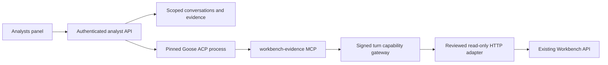

# Embedded analysts

The optional Analysts panel embeds **Goose 1.57.0 over ACP**. FastAPI owns
conversation identity, evidence, admission and lifecycle. Goose supplies the model
and tool loop. Rust remains the financial runtime; the existing worker and
independent verification continue to own calculation and publication.

This is a read-only pilot, disabled by default. The two roles share the same
restricted tools and differ in their analysis instructions:

| Role | Focus |
|---|---|
| Operations Analyst | Intake provenance, job status, stale results, publication and delivery exceptions |
| Portfolio Analyst | Published risk/income/scenario and allocation results, compatibility and evidence-supported explanations |

Three versioned skills live in `apps/api/app/analyst_skills`: `morning-review`,
`explain-change`, and `job-recovery`, with a shared evidence contract. Recovery
means finding the original job and explaining its state. These workflows do not
retry, cancel, edit, price, optimize or publish. Subagents are not enabled.

## MCP servers and authority

The existing `rates-workbench-mcp`, `rates-workbench-ops` and
`rates-workbench-strategy` entrypoints remain external-client profiles with
explicit grants; see [their documentation](../apps/mcp/README.md). The embedded
pilot starts a separate `workbench-evidence` stdio server, registered in Goose as
`workbench`, with exactly these 15 tools:

`get_state`, `get_health`, `get_books`, `get_books_name_rows`, `get_settings`,
`get_assumptions`, `get_market`, `get_scenarios`, `get_jobs`, `get_jobs_jid`,
`get_jobs_jid_manifest`, `get_jobs_jid_table`, `get_decision_sessions`,
`get_decision_sessions_sid`, `get_models_contracts`.

The API independently validates the allowlist, generated argument schemas,
scope, active turn, revision and budgets. The MCP child receives only a signed,
expiring turn capability; the ordinary API credential stays in the API process.
Analyst administration routes are explicitly excluded from the general MCP
catalog to prevent recursive agent creation and disclosure of private histories.

Each turn starts in a disposable directory with isolated Goose configuration and
an explicit provider environment allowlist. The host removes other extensions,
checks the exact tool roster before inference, and rejects ACP permission,
filesystem and terminal requests. This process separation is **not an OS
sandbox**. Deploy the API/Goose host with appropriate filesystem/network isolation;
the configured executable and provider remain trusted deployment components.

## Setup

### Local OpenRouter quickstart

The local launcher uses **OpenRouter / `anthropic/claude-sonnet-5.5`**, the
[pinned Goose provider's default model](https://github.com/block/goose/blob/v1.57.0/crates/goose-providers/src/openrouter.rs).
Goose itself is the Rust executable; FastAPI supervises it over ACP.

1. Install the verified Goose 1.57.0 binary as described below. The local default
   path is `.data/analyst-runtime/v1.57.0/goose-package/goose.exe` on Windows.
2. Run `bun run setup:analysts`. This installs all API extras and creates the
   ignored `apps/api/.env.analysts` with a random signing secret, executable hash,
   model and local identity. Existing settings and secrets are preserved. For a
   different binary location, run `uv run --no-sync --project apps/api python
   scripts/analysts.py configure --executable <absolute-path>`.
3. Set `OPENROUTER_API_KEY` in that file. It stays server-side. The API reports an
   unavailable provider until the key is supplied; neither setup nor startup
   initiates a model request. Environment variables take precedence over this file.
4. Run `bun run check:analysts` for the deterministic OpenRouter transport check.
   Run `bun run check:analysts:live` for a billed OpenRouter request using only
   synthetic workspace evidence. The live check verifies the selected model's
   tool call and cited answer, without opening the user's database.
5. Run `bun run dev:analysts` and `bun run dev:web`, then open **Analysts**. This
   API launcher loads `.env.analysts`, preserves installed extras and listens on
   `127.0.0.1:8000`, using the same storage defaults as `dev:api`. It replaces the
   ordinary API development command; do not run both on the same port.
   On Windows the launcher disables automatic reload so Uvicorn uses a Proactor
   event loop with subprocess support. Restart it after API code changes; Windows
   `--reload`/multiple-worker Selector loops cannot run the ACP subprocess.

The OpenRouter provider receives `OPENROUTER_API_KEY` automatically. Its host is
the official `https://openrouter.ai`; ambient host, proxy and request-parameter
overrides are not forwarded by default. Any additional forwarded environment
keys require an explicit deployment allowlist. Model/provider requests contain
the user's prompt, bounded conversation context and evidence returned by tools.
See [Goose provider configuration](https://goose-docs.ai/docs/getting-started/providers).
Change `WORKBENCH_GOOSE_MODEL` to select another approved tool-capable model and
repeat the live check. This quickstart is local development; production identity
and rollout requirements below still apply.

### Deployment configuration

1. Install API extras with `uv sync --project apps/api --extra dev --extra analysts`
   (retain `--extra iceberg` if that deployment uses Iceberg).
2. Obtain the approved Goose **1.57.0** binary from its
   [official release](https://github.com/block/goose/releases/tag/v1.57.0).
   Verify the archive against its published digest, then calculate the extracted
   executable's SHA-256. Configure an absolute executable path and that executable
   digest; the runtime also checks `--version` before each session.
3. Supply the variables in `apps/api/.env.example`: enable the feature, choose an
   approved provider/model, set a random analyst secret of at least 32 characters,
   and explicitly name only the provider environment keys to forward. No provider
   credentials or local Goose profile are inherited by default, except the
   OpenRouter key when that provider is explicitly selected. Provider IDs
   admitted by configuration are openai, anthropic, ollama, google, openrouter,
   azure, bedrock and databricks; each deployment must validate its chosen provider.
4. Point `WORKBENCH_ANALYST_API_URL` at this same tenant/workspace API origin.
   Plain HTTP is restricted by the existing adapter to loopback; remote origins
   require HTTPS. Use durable SQLite/PostgreSQL storage, not the test memory queue.
5. Restart the API with the installed extras retained, for example from the root:
   `uv run --no-sync --project apps/api uvicorn app.main:app --app-dir apps/api --port 8000`.
   Alternatively include `--extra analysts` and any other deployment extras on
   every `uv run`; an ordinary syncing launch without those extras removes them.
   Enabled startup creates the three additive analyst tables;
   initialize these once before starting multiple replicas. Open **Analysts** in
   the workspace. Feature configuration does not start inference until a user
   submits a turn.

For local development only, set `WORKBENCH_ANALYST_LOCAL_USER`. Production uses
the existing authenticated gateway and service API token, plus gateway-injected
`x-workbench-user`, `x-workbench-identity-time` (Unix seconds) and
`x-workbench-identity-signature` headers. The signature is lowercase hex HMAC-SHA256
using `WORKBENCH_ANALYST_SECRET` over newline-separated user, timestamp, tenant,
workspace, HTTP method and backend path (e.g. `/analysts/conversations`). The API
requires a timestamp within 60 seconds. The gateway must replace client-supplied
identity headers. Do not put either secret in the browser. The same secret must
be deployed to API replicas. Rotation invalidates outstanding turn capabilities.

## Persistence, limits and cancellation

Conversations belong to a principal within one tenant/workspace. Turns retain the
request ID/fingerprint, admitted revision, workflow, prompt, draft answer, status,
runtime executable hash, provider/model and instruction hash. Evidence captures
the tool, arguments, bounded result and result hash. Captured evidence is written
once and its hash is checked on retrieval. Full pages load on demand in the UI.
These records can contain portfolio data; apply the database's access, backup and
retention policies. No automated retention or transcript deletion is included.

Admission permits two active turns per workspace and one per conversation, up to
50 turns per conversation. A turn allows 180 seconds, 24 tool reads, 100 rows per
page, 128 KB per captured result, and 64,000 output characters. Goose also has a
12-turn loop limit and 4,096-token response setting. These are resource bounds,
not a measured token-spend or dollar-budget guarantee. History replay uses the
latest six turns within a 48,000-character context bound.

Exact request retries return the original turn. Changed input with the same ID
is rejected. Revision changes block further reads and prevent successful final
completion. A successful answer must cite at least one captured successful
evidence ID and cannot cite an unknown ID. Citation checks **do not establish
that every sentence or number is supported**; answers remain draft explanations.
Job status pages are point-in-time observations, not a transactionally frozen
snapshot of every job. Compare immutable completed job outputs for financial
conclusions.

Stopping an answer cancels only that analyst turn; financial jobs continue. The
host terminates its Goose/MCP process tree. On a crash, durable history and
evidence survive; abandoned turns expire and become interrupted when reopened.
There is no automatic paid retry or resubmission. Historical API reads remain
possible without a compatible executable once the tables exist; the panel also
keeps that history accessible when inference is disconnected.

## Validation and remaining gates

Focused tests cover ownership, scoped admission, exact retries, cancellation,
deadlines, evidence integrity, revision conflicts, forged identities/capabilities,
read-only tool dispatch, ACP stream handling and provider environment isolation.
Browser fixtures cover disconnected setup and reopening/stopping conversations.

Local validation on 2026-11-01: the full API gate completed with **1,274 passed**;
the final focused analyst/ACP run had **12 passed**, MCP had **43 passed**, and
the browser fixtures had **3 passed**. The TypeScript/Vite build, architecture
checks and their 10 fixtures, generated HTTP/native/MCP contracts and whitespace
checks passed. API and MCP environments use PyArrow 25.0.1, retaining the API's
existing version; the MCP compatibility range now includes that version.

A separate mixed API test selection had 82 passes and one order-dependent failure
in `test_state_fingerprints_change_only_for_the_edited_input`. That failure also
reproduced with the original API entrypoint and analyst tests excluded. Its full
40-test module passed on its own, and it passed in the complete API gate. The
pilot does not modify the underlying input-fingerprint implementation or fixtures.

Run `uv run --no-sync --project apps/api python scripts/check_goose_analyst.py
<absolute-goose-path>` for the real pinned Goose ACP and MCP round trip against a
deterministic local OpenAI-compatible fixture. It verifies extension discovery,
the exact tool roster, one MCP evidence read and streamed response, without a
model account or production financial data. This is not live-provider validation.

The OpenRouter follow-through on 2026-11-03 passed **16 focused API/setup tests**
and the real pinned Goose OpenRouter provider against the local fixture (two
inference calls and one MCP evidence read). The OpenAI fixture also still passed.
Architecture and generated HTTP/MCP checks passed. Missing-key preflight,
provider-specific credential isolation, preservation of existing secrets and the
Windows subprocess-compatible launcher are covered by the focused tests.
On 2026-11-09, `bun run check:analysts:live` passed against the configured
OpenRouter account with `anthropic/claude-sonnet-5.5` and Rust Goose 1.57.0. The
live model made one MCP evidence read and returned the required cited answer.
Only synthetic workspace evidence was sent; no user database or financial worker
was used. This verifies live inference and tool use, not production gateway,
database concurrency or representative portfolio answer quality.

Production rollout still needs authenticated
gateway integration, PostgreSQL concurrency acceptance, host isolation and
capacity checks, retention policy and representative answer-quality evaluation.
Future compute/edit workflows need separately reviewed grants, application
authorization and existing durable-job/publication contracts; adding a skill
alone must never expand authority.
